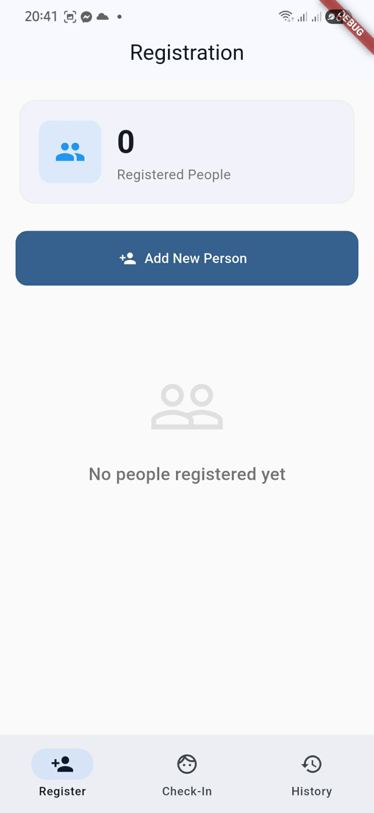
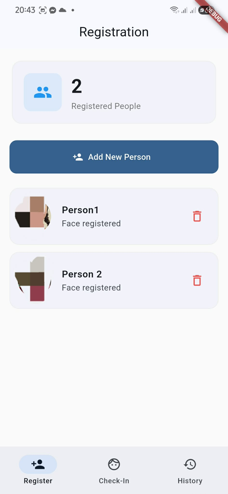
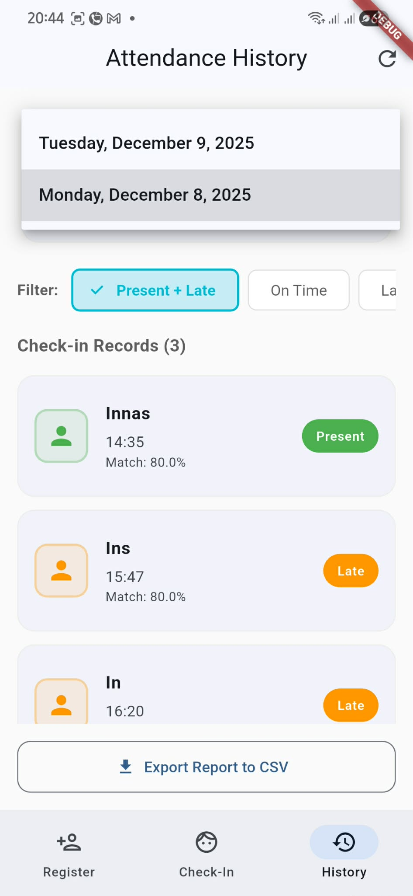
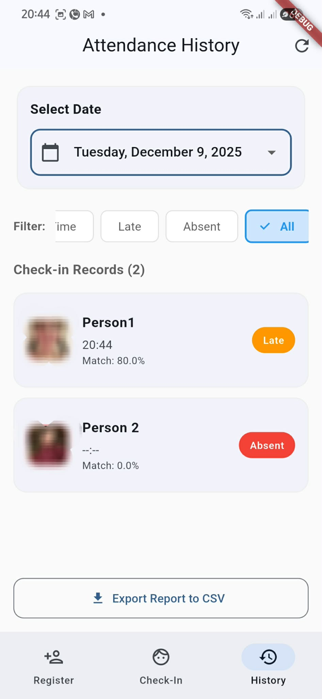
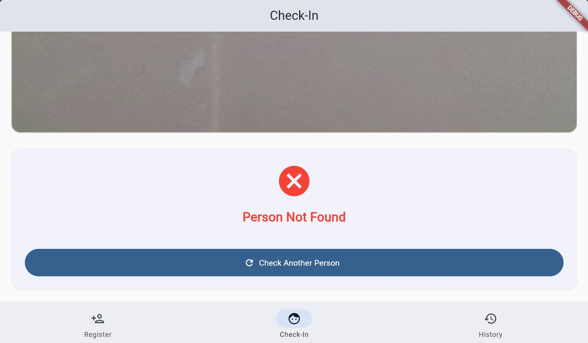
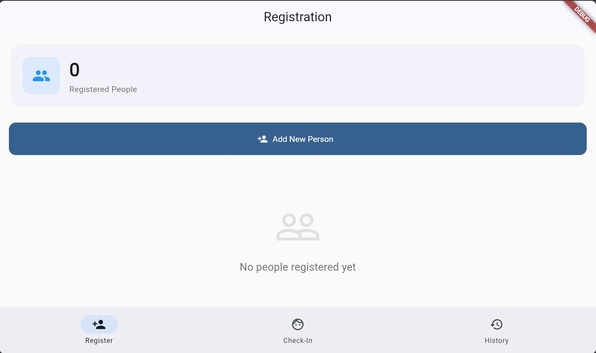
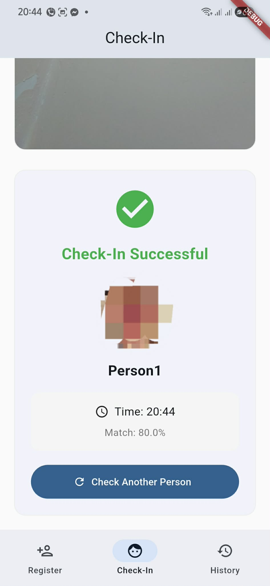
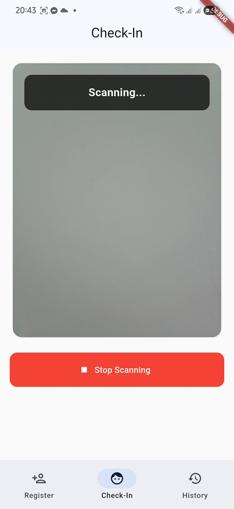

### Attendance Appointmen Flutter + FastAPI (Face Recognition)

This project is a mobile attendance application built with Flutter and a FastAPI-based face recognition backend.
Employees can mark their attendance by scanning their face, and the system automatically verifies their identity using InsightFace embeddings.

### ✨ Features

- Cross-platform (iOS, Android)
- Responsive, modern UI
- Register new employees by capturing a face image
- Extract and store face embeddings through FastAPI
- Real-time face recognition with start/stop scanning mode
- Prevent duplicate sign-in (employee already registered today)
- Daily attendance list with Present, Late, Absent badges
- Date filters + reporting view
- Export data for CSV reporting
- Built with Flutter Clean Architecture (data, domain, presentation)
- State management using Cubit (flutter_bloc)

### 📸 Screenshots

Here’s a quick look at the app:

   
  
   
   
  

   
  

  
  
  

---

### 1- 🛠️ Tech Stack

- **Mobile App:** Flutter
- **Back-end/API:** FastAPI 
- **Platforms:** iOS, Android
- **Hive (local DB)** 
- **ApiCall:** Dio or HTTP
- **state management:** Cubit(bloc package)
- **FastApi**

### 2- Backend (FastAPI)

Face detection

Embedding extraction

Face similarity comparison

Store and query embeddings

Optimized for mobile usage

### 3- Wireframes ###

face recognition

Attendance List

### 4. Project Structure (Clean Architecture) ###

.png)

### A few resources to get started:

- [Cookbook: Useful Flutter samples](https://docs.flutter.dev/cookbook)

- [online documentation](https://docs.flutter.dev/), which offers tutorials,
samples, guidance on mobile development, and a full API reference.

- [Bloc/Cubit Pattern](https://medium.com/@yamen.abd98/clean-architecture-in-flutter-mvvm-bloc-dio-79b1615530e1)
  
- [Hive local DB + addapters](https://medium.com/p/a3a7c78fcd89)

- [camera implementation](https://stackoverflow.com/questions/62776868/how-to-allow-use-of-camera-in-the-flutter-application)

- [FastAPI](https://fastapi.tiangolo.com/)

### repo of the API
[InsightFace (buffalo_l model)](https://github.com/benyahia-raouf/faceApi) 
